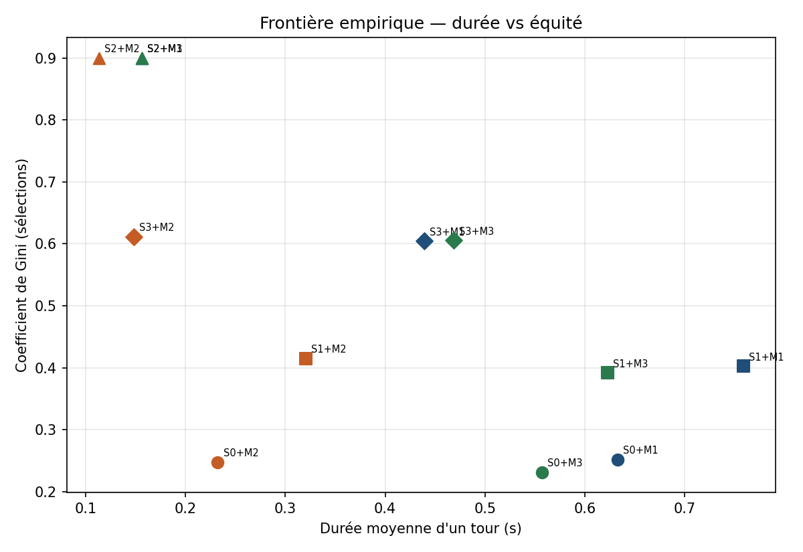

# Orchestration de l'apprentissage fédéré : plan de contrôle


API REST qui orchestre des **tours d'apprentissage fédéré** (FL) et compare plusieurs
façons de choisir les appareils participants selon trois critères : **vitesse**,
**nombre de contributions** et **équité** (coefficient de Gini).

> Projet de recherche en informatique (INF1036) — Université du Québec à Trois-Rivières,
> été 2026 · Auteur : **Pape Macodou Seye**



## En bref

- **API REST de 7 routes** avec FastAPI, validation Pydantic et documentation OpenAPI 3.0
- **5 stratégies de sélection** des participants et **3 mécanismes** de gestion des
  retardataires, interchangeables grâce au **patron Strategy** (classes abstraites Python)
- **Évaluation de 12 combinaisons** : 100 appareils simulés, 10 sélectionnés par tour,
  50 tours × 3 graines aléatoires
- **Tests automatisés** (pytest, 10/10) et reproduction complète des résultats avec `make all`

## Le problème

En apprentissage fédéré, le modèle est entraîné directement sur les appareils (téléphones,
capteurs…) : seules les mises à jour du modèle sont envoyées au serveur, jamais les
données personnelles. Le serveur doit alors décider, à chaque tour :

1. **Qui sélectionner ?** Les appareils les plus rapides, au hasard, ceux qui ont le plus de données ?
2. **Combien de temps attendre ?** Un appareil lent peut bloquer tout le tour.
3. **Est-ce équitable ?** Choisir toujours les mêmes appareils biaise le modèle.

Ce projet construit le **plan de contrôle** qui prend ces décisions et mesure leurs effets.

## Résultats principaux

| Combinaison | Durée moyenne d'un tour | Gini (0 = équitable) | Quand l'utiliser |
|---|---|---|---|
| S2 + M2 | 0,113 s | 0,90 | La vitesse prime |
| **S3 + M1** | **0,439 s** | **0,60** | **Meilleur compromis** |
| S0 + M1 | 0,633 s | 0,25 | L'équité prime |

La stratégie hybride **S3** réduit l'inéquité d'un tiers par rapport à la sélection des plus
rapides (Gini 0,60 contre 0,90), tout en restant plus rapide que la sélection aléatoire.
Tous les chiffres sont dans [`CHIFFRES_RAPPORT.md`](CHIFFRES_RAPPORT.md) et les fichiers CSV.

## Stratégies et mécanismes

| Code | Stratégie de sélection | | Code | Gestion des retardataires |
|---|---|---|---|---|
| S0 | Aléatoire (référence) | | M1 | Attendre 100 % des contributions |
| S1 | Proportionnelle au volume de données | | M2 | Clore à 80 % des contributions |
| S2 | Les plus rapides | | M3 | Clore après un délai maximal |
| S3 | Hybride : 5 rapides + 5 au hasard | | | |
| S4 | Par réputation (fiabilité) | | | |

## Architecture

| Fichier | Rôle |
|---|---|
| `coordinator.py` | API REST (FastAPI) : inscription, tours, contributions, FedAvg, métriques |
| `strategies.py` | Stratégies de sélection S0 à S4 |
| `stragglers.py` | Mécanismes M1 à M3 |
| `metrics.py` | Coefficient de Gini |
| `experiment.py` | Évaluation des 12 combinaisons (temps simulé, sans appel HTTP) |
| `approfondissement.py` | Comparaison S0 / S4 avec tests statistiques |
| `plot_figures.py` | Graphiques de Pareto |
| `federated_simulator.py` | Simulateur d'appareils fourni dans le cadre du cours |
| `tests/test_core.py` | Tests automatisés |

Ajouter une nouvelle stratégie ne demande aucune modification du coordinateur :
il suffit de créer une sous-classe de `StrategieSelection` (principe ouvert/fermé).

## API REST

| Méthode | Route | Rôle |
|---|---|---|
| POST | `/v1/clients` | Inscrire un appareil |
| DELETE | `/v1/clients/{id}` | Désinscrire un appareil |
| GET | `/v1/round` | État du tour en cours |
| POST | `/v1/round/start` | Sélectionner les participants et ouvrir un tour |
| GET | `/v1/round/{id}/parameters` | Récupérer le modèle global |
| POST | `/v1/round/{id}/contributions` | Soumettre une contribution (clôture + FedAvg) |
| GET | `/v1/metrics` | Compteurs et coefficient de Gini |

Les erreurs suivent les codes HTTP standards (403, 404, 409, 422) avec un corps structuré
`{ "erreur", "code", "tour_id" }`. Spécification complète : [`openapi.yaml`](openapi.yaml).

## Lancer le projet

Python 3.11 recommandé (3.9 minimum).

```bash
pip install -r requirements.txt

# Lancer l'API → documentation interactive sur http://127.0.0.1:8000/docs
python3 -m uvicorn coordinator:app --reload

# Reproduire tous les résultats : expériences, figures et tests
make all
```

Commandes séparées : `python3 experiment.py`, `python3 approfondissement.py`,
`python3 plot_figures.py`, `python3 -m pytest -q`.

## Limites

Le « modèle » est un vecteur de 8 nombres fourni par le simulateur : le projet évalue le
plan de contrôle (sélection, attente, équité), pas la précision d'un vrai réseau de neurones.

## Technologies

Python · FastAPI · Pydantic · Uvicorn · pytest · matplotlib · OpenAPI 3.0 · Git

## Auteur

**Pape Macodou Seye** — étudiant en génie logiciel, UQTR
[GitHub](https://github.com/papeseye21) · Pape.Macodou.Seye@uqtr.ca
